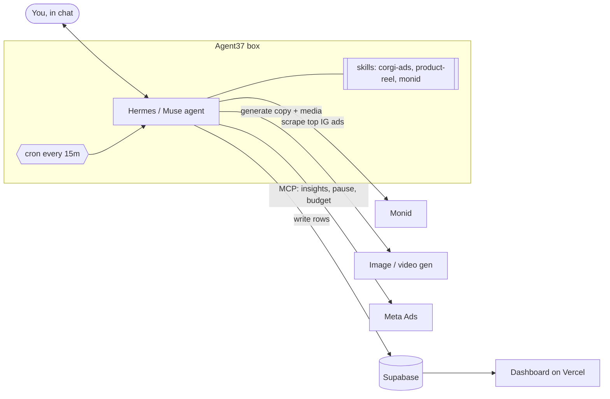

# Corgi Ads 🐕📣

**An ad agent you talk to.** It studies what's working for competitors, makes the creative, launches it on Meta, then watches live spend and tells you where the money should go. You approve; it acts.

> **Status:** Hackathon project — "Build an Agent" Hackathon (Agent37 at Corgi Cafe), San Francisco, 2026-10-07. Reference build, built by Ben and Zen.

[Demo page](https://corgi-hack-tau.vercel.app) · [Corgi Pop landing page](https://corgi-hack-tau.vercel.app/corgi-pop/)

## What it does

The test client was **Corgi Pop**, a made-up peach soda. In one chat, the agent:

1. **Researches** — Monid pulls the top competitor Instagram ads; the agent names the hook, format and offer.
2. **Creates** — writes three hook variants; the `product-reel` skill turns product photos into finished vertical video ads (three 15-second ads shipped in the demo).
3. **Launches** — picks manual vs Advantage+ placement and says why, then stages the ads on Meta through Meta's ads MCP server.
4. **Monitors** — a 15-minute cron reads ad-level insights and snapshots them.
5. **Directs spend** — proposes a pause or budget move; it runs only after a human says "approve".

**Design rule:** the agent is the only thing that touches Meta. Dashboards only read.

**What actually worked on the day:** the reel uploaded to the ad account, and reads, pausing and budget edits worked. Agent-side ad *creation* was blocked because the Meta app behind the connector was still in Development mode (documented in [`docs/meta-setup.md`](docs/meta-setup.md)).

## How it works

| Step | Data |
|---|---|
| Research | `competitor_ads` |
| Create | `creatives` |
| Launch | Meta, `creatives.meta_ad_id` |
| Monitor | `ad_snapshots` |
| Direct spend | `recommendations`, Meta |

## Repo layout (across branches)

Work from the event is split across branches; the proposed cleanup merges them into `main` and makes `main` the default.

| Path | Branch | What |
|---|---|---|
| `hermes/` | all | MCP config and the `corgi-ads`, `product-reel` and `monid` skills |
| `supabase/schema.sql` | all | Shared data contract (agent writes, web reads) |
| `docs/` | all | Demo script, Meta setup, privacy policy |
| `muse/` | `main`, `ben/meta-setup` | Agent37 Muse app (vendored from Agent37's MIT example) with Corgi skills and Monid tools; media Library and read-only Meta Ads dashboard on `main` |
| `landing/` | `ben/meta-setup` | The deployed demo page, Corgi Pop product page, `/agent` console and API routes |
| `examples/ads/` | `ben/meta-setup` | Three sample 15s ads and the variant script |

## Stack

Agent37 (Hermes / Muse) · Meta ads MCP server · Monid · Supabase · Node/Express (Muse) · static HTML + Vercel functions (demo page) · Python + FFmpeg (reel checks) · Claude as a fallback agent behind the `/agent` console.

## Run it

1. **Meta:** one Business portfolio owning the ad account and Page; a system user with the **Employee** role and an ads token (scopes in [`docs/meta-setup.md`](docs/meta-setup.md)). Set an account spending limit.
2. **Agent:** copy `.env.example` into the agent host's env file and fill it in; merge `hermes/config.mcp.yaml` into the agent's config; copy the skills into the agent's skills folder; smoke test with *"list my ad accounts and today's spend"*.
3. **Monitor:** `hermes cron create "every 15m" "Run the corgi-ads monitor loop and report" --skill corgi-ads`.
4. **Supabase:** run `supabase/schema.sql`.
5. **Demo page:** `cd landing && vercel deploy` (from `ben/meta-setup`).

Generation can spend Monid credits, and launching ads spends real money. Secrets live only in env files and the deploy platform's secret store.

## Credits

Built by Ben ([benikigai](https://github.com/benikigai)) and Zen at the Agent37 "Build an Agent" hackathon at Corgi Cafe. Muse is adapted from [Agent37's examples](https://github.com/agent37-platform/examples) (MIT).
